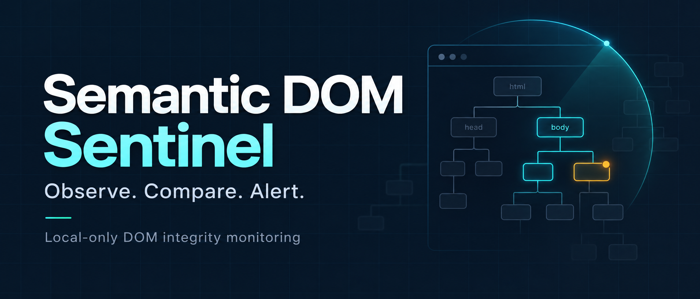
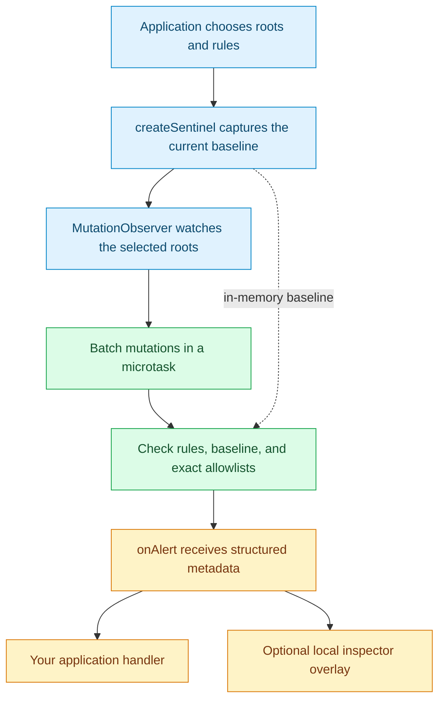

# Semantic DOM Sentinel

### Observe the DOM that matters. Get structured alerts.

A **TypeScript browser library for deterministic DOM integrity monitoring**. Select the roots and rules that matter, capture a baseline after hydration, and receive structured alerts when observed changes match its checks.

**Local-only runtime. No runtime dependencies. No blocking or automatic repair.**

[](https://github.com/GuardrailEngine/semantic-dom-sentinel/actions/workflows/ci.yml)
[](https://github.com/GuardrailEngine/semantic-dom-sentinel/actions/workflows/coverage.yml)
[](LICENSE)
[](#security-and-privacy)

[Quick start](#quick-start) · [How it works](#how-it-works) · [Alert reference](#alert-reference) · [Security & privacy](#security-and-privacy) · [Contribute](CONTRIBUTING.md)

> [!IMPORTANT]
> **Observability, not prevention.** This early MVP is a monitoring signal, not a security boundary. It does not block attacks, repair markup, or replace CSP, Trusted Types, secure coding, or server-side controls.

## Why watch DOM integrity?

A checkout form's `action`, a payment button's `formaction`, or a critical link's `href` can change after a page renders. When you need visibility into selected changes, a full-page mutation log can be more noise than signal.

Semantic DOM Sentinel lets you describe **what to watch**, **which values are expected**, and **where to deliver alerts**. It uses `MutationObserver` and explicit rules—not AI, inferred intent, or remote analysis.

| Built for focused observation | What that means |
| --- | --- |
| **Explicit scope** | Monitor application-chosen DOM roots and CSS selectors, rather than automatically watching the whole page. |
| **Deterministic checks** | Compare watched attributes, optional text, selector membership, and selected inserted elements. |
| **Local processing** | No network calls, analytics, persistence, or telemetry in the runtime package. |
| **Application-owned response** | Receive a typed callback; optionally inspect alerts in a local overlay. The monitor never rewrites protected content. |

Useful starting points include **checkout monitoring**, **payment-form integrity checks**, **critical-link monitoring**, and **SPA DOM diagnostics**. These are observation use cases, not guarantees of detecting or preventing an attack.

## How it works



The application must initialize the monitor **after hydration and after establishing its intended trusted state**. Baseline capture is synchronous: the library does not determine when a page is ready or whether its initial state is trustworthy. Alerts are emitted for detected conditions; routine changes do not all become alerts.

## Build and install locally

The package is **not currently available on the public npm registry**. Start from source instead of running `npm install semantic-dom-sentinel`:

```sh
git clone https://github.com/GuardrailEngine/semantic-dom-sentinel.git
cd semantic-dom-sentinel
npm ci
npm run build
npm pack
```

`npm pack` creates `semantic-dom-sentinel-0.1.0.tgz` in the repository root. To install it in your application, run the install command from the application's directory. For example, if the application and cloned repository are sibling directories named `my-app` and `semantic-dom-sentinel`:

```sh
cd ../my-app
npm install ../semantic-dom-sentinel/semantic-dom-sentinel-0.1.0.tgz
```

If the directories are elsewhere, use the path to the generated tarball from your application directory.

The build generates ESM, CommonJS, a browser IIFE bundle at `dist/index.global.js`, and TypeScript declarations. These are local build outputs; they are not prebuilt files in the repository. The runtime package has no runtime dependencies.

### Package entry points

Bundlers should import from the package root. The `browser` export condition and the legacy `browser` field both select the browser-compatible ESM build at `dist/index.js`; Node ESM and CommonJS consumers use their corresponding builds, and TypeScript uses the declaration file. The `exports` map intentionally exposes only the package root.

For a page without a bundler, load the IIFE as a regular script. It exposes `window.SemanticDomSentinel`; do not import this IIFE as an ES module:

```html
<script src="/node_modules/semantic-dom-sentinel/dist/index.global.js"></script>
<script>
  const { createSentinel } = window.SemanticDomSentinel;
</script>
```

The `unpkg` and `jsdelivr` package fields point to the same IIFE for direct CDN script loading after the package is published. They are not module entry points.

## Quick start

Call this only after your application has finished hydration and established its intended trusted state. The example assumes a `#checkout-root` containing a `form[data-checkout]` and a `button[data-payment-submit]`.

```ts
import { createSentinel } from "semantic-dom-sentinel";

const checkoutRoot = document.querySelector("#checkout-root");
if (!(checkoutRoot instanceof HTMLElement)) {
  throw new Error("Checkout root was not found");
}

const sentinel = createSentinel({
  roots: [checkoutRoot],
  rules: [
    {
      id: "checkout-form",
      selector: "form[data-checkout]",
      watchAttributes: ["action", "method"],
    },
    {
      id: "payment-submit",
      selector: "button[data-payment-submit]",
      watchAttributes: ["type", "formaction", "aria-label"],
      watchText: true, // Only for a fixed, non-sensitive button label.
    },
  ],
  onAlert(alert) {
    console.warn("DOM integrity alert", alert);
  },
});

window.addEventListener("pagehide", () => sentinel.stop(), { once: true });
```

Changing the watched form's `action` after observation starts can produce an `attribute-changed` alert. The change itself is **not blocked or reversed**.

Use stable rule IDs and narrow selectors. Do not put personal or secret data in either: rule IDs and selectors appear in alert metadata. See the [checkout integration example](examples/checkout.ts) for an implementation with the optional inspector and a cleanup function.

### Add the optional inspector

For local diagnostics, mount the inspector before creating the monitor and forward alerts to it:

```ts
import { mountInspectorOverlay } from "semantic-dom-sentinel";

const inspector = mountInspectorOverlay();

// In your createSentinel options:
// onAlert: (alert) => inspector.push(alert)

// During application cleanup, call both:
// sentinel.stop();
// inspector.destroy();
```

The overlay displays alert metadata using `textContent` in a closed Shadow DOM. It does not read or change protected nodes. It is a diagnostic UI, not an isolated security boundary.

## Alert reference

| Reason | Observed condition |
| --- | --- |
| `attribute-changed` | A watched attribute differs from the baseline and is not an allowed value. |
| `text-changed` | Opted-in, normalized text differs from the baseline and allowed text values. |
| `protected-element-added` | A newly added or newly matching element satisfies a configured rule. |
| `protected-element-removed` | A previously matched element is removed from the monitored scope. |
| `protected-element-unmatched` | An existing element stops matching its configured selector. |
| `risky-element-added` | An inserted element matches a built-in or additional risky-node selector. |

Built-in risky-node selectors are `iframe`, `object`, `embed`, `script`, and `[srcdoc]`. Here, “risky” is a selector category—not a verdict that an element is malicious. Detection applies within the selected roots; iframe documents are not automatically observed.

**Illustrative attribute-change payload:**

```json
{
  "id": 1,
  "targetId": "node-1",
  "reason": "attribute-changed",
  "ruleId": "checkout-form",
  "selector": "form[data-checkout]",
  "attribute": "action",
  "detectedAt": 1762210000000
}
```

Alert objects contain **no changed attribute values, changed text, input values, or live DOM nodes**. `targetId` is an opaque, per-controller identifier. The callback stays in the current page; anything your own handler sends elsewhere is your application's responsibility.

## Tune rules to your application

### Watch only what matters

`watchAttributes` defaults to `action`, `aria-label`, `aria-controls`, `formaction`, `href`, `method`, `name`, `role`, `src`, `target`, and `type`. Supply a narrower list when practical. Attributes such as `class`, `style`, and `data-*` are compared for value changes only if you explicitly watch them.

Selector membership is checked separately: a `class` change can still produce a membership alert if it makes an element enter or leave a rule's selector match.

### Allow intentional changes

Exact allowlists describe known application states:

```ts
const detailsRule = {
  id: "expandable-payment-details",
  selector: "button[data-payment-details]",
  watchAttributes: ["aria-expanded"],
  allowAttributeValues: { "aria-expanded": ["true", "false"] },
};
```

`watchText` is opt-in. It compares normalized `textContent` in memory; `allowTextValues` supplies exact expected labels. Keep text rules narrow and limited to non-sensitive, application-owned labels. **Never use them on inputs, account details, or user-entered content.** The library never reads input `.value` properties.

### Manage the lifecycle deliberately

| Method | Behavior |
| --- | --- |
| `refresh()` | Accepts the current DOM as the next baseline. Use only after a trusted, intentional application transition; refreshing during a compromise would accept that state. |
| `stop()` | Disconnects observers and discards queued work. Safe to call more than once. |

There is no automatic repair, node removal, click blocking, quarantine, or recovery. Applications decide what to do with alerts. Full interfaces are documented in [`src/types.ts`](src/types.ts).

## Security and privacy

**What this monitor cannot establish is as important as what it observes.**

- **A baseline is not proof of trust.** A compromise present before initialization may be included in the baseline. The monitor may miss changes outside configured roots or rules.
- **Hostile page scripts can interfere.** Same-page scripts may stop or suppress monitoring. Privileged browser extensions are outside a reliable page-level protection boundary.
- **Iframe insertion is not iframe inspection.** Cross-origin documents are out of scope under the same-origin policy. Even same-origin iframe documents require separate, explicit roots.
- **Local-only does not mean no in-memory content.** Opted-in text is normalized and retained privately for comparison; do not select sensitive text. Alert objects omit changed content, but include your configured rule IDs and selectors.
- **Observation is not attack prevention.** This library does not prevent DOM-based XSS, clickjacking, phishing, payment redirection, or data theft. A detected change is not proof of an attack, and the absence of an alert is not proof of safety.

Use strict Content Security Policy, Trusted Types where supported, safe DOM APIs, output encoding, dependency review, and server-side validation alongside—not instead of—this monitor. See [SECURITY.md](SECURITY.md) for scope and responsible reporting. The project does not claim that this concept is unique or that security effectiveness has been proven.

## Development and verification

```sh
npm ci
npm run lint
npm run typecheck
npm test
npx playwright install chromium
npm run test:e2e
npm run build
```

The tests exercise baseline capture, allowlists, attribute/text changes, selector membership, element additions/removals, repeated mutations, SPA-style updates, payment controls, injected iframes, and a network-boundary assertion. Performance smoke tests use an **8,000-element tree** and a **1,000-mutation synchronous batch**. These are test workloads, not a published latency benchmark or a guarantee of production performance.

The [CI workflow](.github/workflows/ci.yml) runs lint, typecheck, and Chromium integration tests. The separate [coverage workflow](.github/workflows/coverage.yml) runs the unit and performance suite with coverage enabled and retains the report as a downloadable Actions artifact for 14 days. Its badge reports workflow status, **not a coverage percentage**.

## Help shape the signals

Contributions are welcome: focused reproductions, rule examples, tests for expected versus unexpected DOM changes, and documentation improvements are valuable starting points. Read [CONTRIBUTING.md](CONTRIBUTING.md) before opening a pull request.

Keep the runtime **framework-agnostic, deterministic, local-only, and alert-only**. Changes to that boundary require a separate security design review.

[Report a reproducible issue](https://github.com/GuardrailEngine/semantic-dom-sentinel/issues) · [Review contribution guidance](CONTRIBUTING.md) · [Read the security policy](SECURITY.md)

## License

[MIT](LICENSE). Use, study, and adapt it under the license terms.
